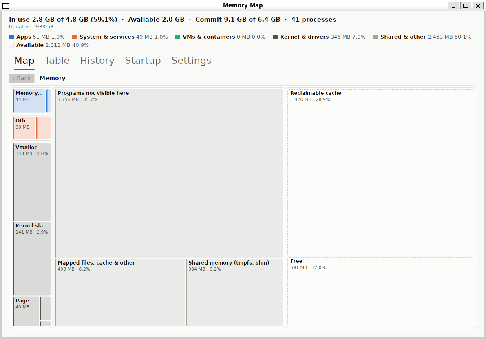

# memory-map

A desktop app for Windows and Linux that shows the PC's RAM as a live treemap — like SequoiaView does
for disk space — so you can see at a glance what is using memory, including memory no
app owns (kernel pools, shared pages).

Built in C# (.NET 10) with Avalonia. **State:** version 0.5.1 runs on Windows and Linux (amd64 and
arm64), compiled ahead of time; signed Windows releases are in progress (`GOALS.md`). Source: `github.com/yunniko/memory-map`.

## Download

[Releases](https://github.com/yunniko/memory-map/releases) carry, for each version:
- `MemoryMap-<version>-win-x64.zip` — Windows 10/11, 64-bit: extract it and run `MemoryMap.exe`, keeping
  its two libraries beside it; nothing to install. Up to 0.4.1 this was one file,
  `MemoryMap-<version>-win-x64.exe`.
- `memory-map_<version>_amd64.deb` — Debian, Ubuntu and similar on Intel or AMD:
  `sudo apt install ./memory-map_<version>_amd64.deb`. From 0.4.1, `memory-map_<version>_arm64.deb` is
  the same for 64-bit ARM, such as an ARM Chromebook's Linux (`dpkg --print-architecture` says which).
- `MemoryMap-<version>-linux-x64.tar.gz` (Intel or AMD) and `MemoryMap-<version>-linux-arm64.tar.gz`
  (64-bit ARM) — any Linux: extract it and run `MemoryMap` in its folder. Up to 0.4.1 these were single
  files, `MemoryMap-<version>-linux-x64` and `-linux-arm64`.
- `MemoryMap-<version>-notices.zip` and `SHA256SUMS` — the licences and the checksums.

Releases are built by GitHub Actions from a version tag (`.github/workflows/release.yml`). See the
code signing policy below for how the Windows exe is signed.

## What it does

- **Map:** RAM in six groups (Apps, Windows & services, WSL/Docker VMs, Kernel & drivers,
  Shared & other, Available) with each app as a tile sized by its private working set,
  refreshed every second. Hover for details; click to zoom into a group or app; Back, Esc
  or the mouse back button to return.
- **Right-click a tile:** *End process* (always confirmed) and *Open file location*.
- **Table:** the same items as a list, largest first within each group, with process counts and PIDs.
- **History:** the last 5–60 minutes of memory in use, kernel pools and the five biggest apps.
- **Tray:** a gauge of RAM in use; an alert when available memory runs low; closing the
  window hides it to the tray (*Exit* on the tray menu quits).
- **Startup:** every program that starts at sign-in, whether it is running now and its memory,
  *Show on map* and *Open file location*, and a switch for each. Switches use the same flag
  Windows Settings uses; nothing is deleted, so every switch can be undone. Entries for every user
  of the PC ask for administrator rights for that one change; Store apps' switch opens Settings.
- **Settings:** refresh interval, a slower refresh while hidden (off by default), alert
  threshold, close-to-tray, titles above the map's groups (off: each group is just an outline); saved in `%APPDATA%\MemoryMap\settings.json`.

On Linux the same tabs work without root: apps are sized by RssAnon, *End process* and *Open file
location* act on your own processes only, the tray is used where the desktop shows one (else closing
quits), and the Startup tab lists XDG autostart entries (switchable) and systemd user services
(listed only). Settings are in `~/.config/MemoryMap/settings.json`.

## Use

- `./scripts/publish.ps1` — build the app, compiled ahead of time, into `publish\win-x64\` and copy its
  three files to `C:\bin` (`-NoInstall` to skip the copy; exit the running app first). Needs Visual
  Studio's C++ build tools.
- `powershell -File scripts/smoke-published.ps1` — start the published app, open every tab and save and
  read back a setting through UI Automation (the real settings file is restored after).
- `dotnet run --project src/MemoryMap.App -c Release` — run from source.
- `dotnet run --project src/MemoryMap.Cli -- --json` — one snapshot as text or JSON;
  `-- --startup` lists the programs Windows starts at sign-in, with their state and memory;
  `-- --startup-set <id> on|off` switches one entry (ids are in `--startup --json`; a machine-wide
  one asks for administrator rights).
- `./scripts/check.ps1` — format check, warnings-as-errors build, all tests.
  Set `MEMORYMAP_SCREENSHOTS=<folder>` to have the window tests save PNGs there.
- `./scripts/crosscheck.ps1` — compare the sampler's totals with Windows' own (WMI).
- `./scripts/startup-crosscheck.ps1` — compare the startup list with Settings → Apps → Startup (read-only).
- `./scripts/startup-roundtrip.ps1` — switch two throwaway entries it creates (and removes) through
  the app's code and through Settings, and check that each side sees the other's change.
  It closes and reopens the Settings app for each check.
- `./scripts/startup-helper-check.ps1 [-Exe <path>]` — run the exes' administrator helper mode
  unelevated with ids it must refuse, and check the exit codes (writes nothing).

## Use on Linux

- `sudo apt install ./memory-map_*.deb` — installs the app (menu entry "Memory Map" and the
  `memory-map` command); `sudo apt remove memory-map` removes it.
- `publish/linux-x64/` (`linux-arm64` on ARM) — the same app as a folder to copy anywhere and run.
- `bash scripts/publish-linux-container.sh` — build both into `publish/` for the machine's own
  architecture, amd64 or arm64, inside an Ubuntu 22.04 container, so they also run on Debian 12 and
  ChromeOS's Linux (needs docker). `scripts/publish-linux.sh` is the build itself; run directly on a
  newer system it refuses, as the result would need a newer glibc.
- `bash scripts/deb-check.sh publish/memory-map_*.deb [image ...]` — lintian, then install, run and
  remove the package in throwaway containers (default `ubuntu:24.04`; CI adds `ubuntu:22.04` and
  `debian:12`; needs docker).
- `python3 scripts/crosscheck-linux.py` — compare the sampler's totals with `free` and `ps`.
- `python3 scripts/startup-roundtrip-linux.py` — switch throwaway autostart entries in temp folders and
  check that systemd's own autostart generator agrees.
- The gate: `pwsh scripts/check.ps1` where PowerShell is installed; CI runs it on Ubuntu too.

Predecessors (one-off snapshots, PowerShell): `C:\bin\memory-report.ps1` (text report)
and `C:\bin\memory-map.ps1` (HTML treemap).

See `HANDOVER.md` for the current state and `docs/decisions/` for why things are the way
they are.

## Code signing policy

Free code signing provided by [SignPath.io](https://about.signpath.io), certificate by
[SignPath Foundation](https://signpath.org). *Status: the application to SignPath Foundation is
pending; releases up to 0.4.0 are unsigned.*

- Only the Windows exe built by the release workflow from this repository's tagged source is
  signed; nothing built elsewhere is submitted. The two libraries beside it come unmodified, with
  their own signatures, from their upstream packages (see `THIRD-PARTY-NOTICES.md`).
- Every signing request is approved by hand in SignPath before it is signed.
- Committers and reviewers: [yunniko](https://github.com/yunniko). Approvers:
  [yunniko](https://github.com/yunniko). The code is written with Claude (Anthropic's AI model)
  in sessions the committer directs and reviews; changes from anyone else come as pull requests
  and are reviewed before merging.

**Privacy policy:** This program will not transfer any information to other networked systems
unless specifically requested by the user or the person installing or operating it. Memory Map
reads memory and process information on the PC it runs on and keeps its settings in a local file;
it makes no network connections.

## Licence

MIT, © 2026 yunniko and Claude (Anthropic): see `LICENSE`. The published programs bundle .NET,
Avalonia, SkiaSharp and other components under their own licences, and the icon is adapted from
Google's Material Symbols (Apache-2.0): see `THIRD-PARTY-NOTICES.md`.
